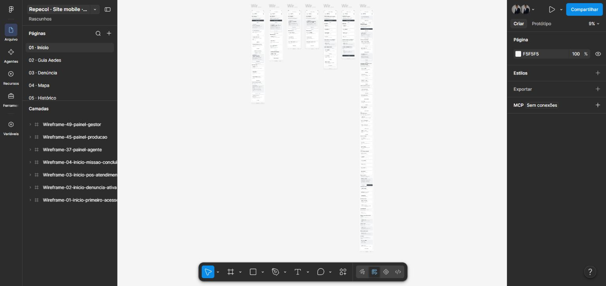

# Aedes Data Lab

Wireframes de uma plataforma web com foco no uso em celular.

Aedes Data Lab é a evolução do projeto Repecol para uma plataforma voltada à prevenção da dengue. O Repecol passa a ser uma referência histórica desta evolução. O trabalho apresentado aqui está na fase de organização dos fluxos e desenho das telas no Figma; não é uma aplicação implementada.

## Arquivo editável dos wireframes

[Abrir wireframes no Figma](https://www.figma.com/design/l2jRvkAj2tgcaD4RqnZD4Y?node-id=2010-2).

A captura acima e as exportações locais são registros históricos. O índice das exportações informa que elas são anteriores à reorganização dos wireframes. Conservam nomes e conteúdos do Repecol, incluindo referências à Equipe Ecoimpactos e a Mogeiro. Esses elementos documentam a origem do material; não descrevem automaticamente a identidade, a equipe ou as entregas atuais do Aedes Data Lab.

## Jornadas representadas nas exportações históricas

- Início, orientações e Guia Aedes.
- Denúncia de foco, localização no mapa e acompanhamento.
- Histórico, conversa com atendimento e notificações.
- Acesso, perfil e privacidade.
- Áreas de agentes, produção, distribuição e gestão.

[Veja as 52 exportações históricas dos wireframes](wireframes/README.md). Elas representam telas e estados de exemplo, não uma contagem de páginas do Figma. Não comprovam o estado atual do arquivo editável, navegação clicável, permissões, envio ou armazenamento de dados.

O link do Figma abre o arquivo de design. A navegação do protótipo e a organização atual de suas páginas não foram verificadas nesta revisão documental.

## Autoria

João Vitor Regis · Aedes Data Lab.

## Licença

A documentação, os wireframes e os designs de autoria de João Vitor Regis estão sob [CC BY 4.0](LICENSE), incluindo o protótipo identificado neste README. Ao reutilizar, credite o autor, informe as alterações e inclua um link para a licença.

Elementos de terceiros conservam seus próprios direitos e licenças. A licença não concede direitos sobre marcas, imagem ou dados pessoais.
