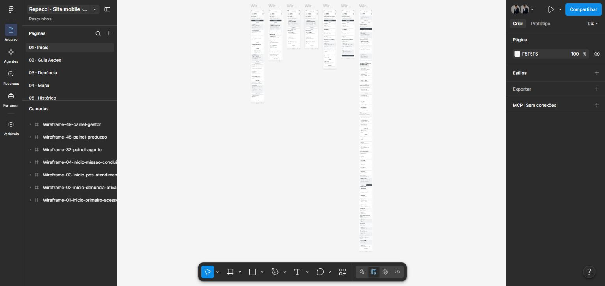

# Aedes Data Lab

Plataforma web, pensada primeiro para o celular, em que moradores de Itambé/PE registram possíveis focos do mosquito da dengue e agentes autorizados acompanham o atendimento.

O Aedes Data Lab é a evolução do projeto Repecol, que agora fica como referência histórica. As telas do produto estão concluídas no Figma e a implementação do site começou: a pasta `site/` tem a estrutura inicial das páginas, ainda sem envio, banco ou autenticação.

## Documentação do produto

- [PRD 2.0](docs/PRD_Aedes_Data_Lab.md): escopo da V1, decisões de produto, requisitos, permissões e critérios de aceite.
- [Start Técnico 2.0](docs/START_TECNICO_Aedes_Data_Lab.md): arquitetura, modelo de dados e ordem de implementação.
- [Guia do site](site/LEIA-ME.md): onde fica cada página e como o trabalho está dividido.

O PRD é a base aprovada para a construção da V1. Ele não indica aplicação em funcionamento nem aprovação institucional. Em caso de conflito com telas antigas, valem as decisões do PRD.

## Design

[Abrir as telas no Figma](https://www.figma.com/design/l2jRvkAj2tgcaD4RqnZD4Y?node-id=2010-2). As telas finais do Figma são a referência visual para o HTML e o CSS.

A captura acima e as [52 exportações da pasta `wireframes/`](wireframes/README.md) são anteriores à versão final das telas. Elas ainda trazem nomes e conteúdos do Repecol, como a Equipe Ecoimpactos, o território de Mogeiro e áreas de chat, produção e distribuição que ficaram fora do escopo. Servem como registro da origem do projeto.

## Autoria

João Vitor Regis · Aedes Data Lab.

## Licença

A documentação, os wireframes e os designs de autoria de João Vitor Regis estão sob [CC BY 4.0](LICENSE), incluindo o protótipo citado neste README. Ao reutilizar, credite o autor, informe as alterações e inclua um link para a licença.

Elementos de terceiros mantêm seus próprios direitos e licenças. A licença não concede direitos sobre marcas, imagem ou dados pessoais.
