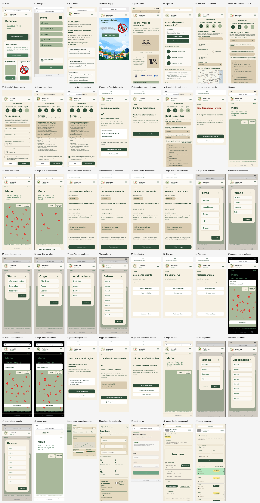

# Aedes Data Lab

Plataforma web, pensada primeiro para o celular, em que moradores de Itambé/PE registram possíveis focos do mosquito da dengue e agentes autorizados acompanham o atendimento.

O Aedes Data Lab é a evolução do projeto Repecol, que agora fica como referência histórica. A documentação e as telas estão concluídas, e a implementação do site começou: a pasta `site/` tem a estrutura inicial das páginas, ainda sem envio, banco ou autenticação. O andamento fica em [docs/MEMORY.md](docs/MEMORY.md).

## Documentação

| Arquivo | Responde | Etapa |
|---|---|---|
| [docs/PRD.md](docs/PRD.md) | O que estamos construindo e por quê? | Planejamento |
| [docs/ARCHITECTURE.md](docs/ARCHITECTURE.md) | Como vamos construir? | Planejamento |
| [docs/DESIGN.md](docs/DESIGN.md) | Como deve parecer? | Planejamento |
| [docs/RULES.md](docs/RULES.md) | Como a equipe e a IA devem programar? | Planejamento |
| [TASKS.md](TASKS.md) | O que construir agora? | Desenvolvimento |
| [docs/DECISIONS.md](docs/DECISIONS.md) | Por que fizemos esta escolha técnica? | Desenvolvimento |
| [docs/MEMORY.md](docs/MEMORY.md) | Em que ponto o projeto está? | Desenvolvimento |
| [docs/SECURITY.md](docs/SECURITY.md) | Como protegemos os dados? | Desenvolvimento |
| [docs/TEST_PLAN.md](docs/TEST_PLAN.md) | Como sabemos que funciona? | Testes |
| [.env.example](.env.example) | Que configurações são necessárias? | Preparação |
| [site/LEIA-ME.md](site/LEIA-ME.md) | Onde fica cada página? | Desenvolvimento |

O PRD é a base aprovada para a construção da V1. Quando outro documento ou uma tela divergir dele sobre comportamento, vale o PRD.

## Como trabalhar

Cada tarefa segue o mesmo ciclo, descrito em [docs/RULES.md](docs/RULES.md):

```
Ler → Entender → Planejar → Implementar → Testar → Revisar → Corrigir → Commit → Atualizar documentação
```

1. Escolha a próxima tarefa livre em [TASKS.md](TASKS.md) e coloque seu nome nela.
2. Crie uma branch para ela, como `feature/registrar-foco`.
3. Leia o requisito no PRD, a tela em `wireframes/` e o DESIGN.md.
4. Implemente, teste com o [TEST_PLAN.md](docs/TEST_PLAN.md) e abra um PR para outra integrante revisar.
5. Depois do merge, marque a tarefa como concluída e atualize o MEMORY.md se o estado do projeto mudou.

Se for usar uma ferramenta de IA, comece pela mensagem de contexto da seção 9 do RULES.md. Ela faz a IA ler a documentação antes de mexer em qualquer arquivo.

## Como rodar

Na fase de HTML e CSS, basta abrir `site/index.html` no navegador. Quando entrarem os módulos JavaScript, use um servidor local, como o Live Server do VS Code, apontando para a pasta `site/`. A configuração do Firebase entra na Fase 6 de [TASKS.md](TASKS.md), a partir do [.env.example](.env.example).

## Design

As telas finais estão na página **Fluxo de telas · Jornada do Usuário** do [Figma](https://www.figma.com/design/l2jRvkAj2tgcaD4RqnZD4Y/Aedes-Data-Lab-%C2%B7-Wireframes-por-p%C3%A1gina?node-id=2014-13) e exportadas em [wireframes/](wireframes/README.md), cada uma ligada ao seu requisito. Cores, fontes e componentes estão no [DESIGN.md](docs/DESIGN.md).



As exportações anteriores, ainda com conteúdo do Repecol, ficam no histórico do Git. A [captura da organização original do arquivo](imagens/organizacao-figma.jpg) registra a origem do projeto.

## Autoria

João Vitor Regis · Aedes Data Lab.

## Licença

A documentação, os wireframes e os designs de autoria de João Vitor Regis estão sob [CC BY 4.0](LICENSE), incluindo o protótipo citado neste README. Ao reutilizar, credite o autor, informe as alterações e inclua um link para a licença.

Elementos de terceiros mantêm seus próprios direitos e licenças. A licença não concede direitos sobre marcas, imagem ou dados pessoais.
